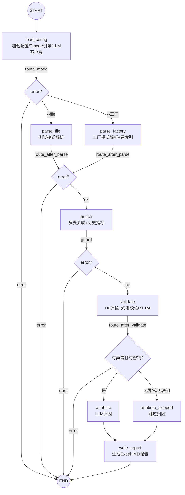

# PCB生产预投业务数据校验Agent

> 一句话定位：读 Excel 报表 → 规则引擎判定异常 → LLM 智能归因 → 输出带制度依据的报告

## 背景

PCB 工厂计划部每天要监控「预投 / 补投 / 余数入库 / 余数报废」四类日报，人工稽查异常（违规补投、重复补投、违规入仓、违规报废）并撰写通报。本工具把「读取报表 → 稽查判定 → 归因建议 → 生成通报」整条流程自动化，替代人工比对与通报撰写。

## 核心能力

- **4 条业务规则插件化（R1–R4）**：违规入仓 / 违规补投 / 重复补投 / 违规报废，每条规则独立文件、可插拔
- **规则参数配置化**：会随业务变的阈值（如「后批订单时间窗口 7 天」）抽到 `config/rules.yaml`，改数值不动代码、不发版
- **LangGraph 状态机编排**：8 节点 + 3 路由，控制流显式化、可单测
- **LLM 归因三层防护**：格式感知重试 + JSON 修复 + 降级兜底，保证归因不丢
- **跨服务知识检索 + HTTP 边界有限重试**：调 B 项目 `/retrieve` 拿制度依据，瞬时错误（网络错/超时/5xx）指数退避重试 2 次、4xx 不重试，重试耗尽静默降级
- **Docker CLI 容器化**：513MB 镜像，一键运行

## 技术栈

| 组件 | 用途 |
|---|---|
| Python 3.14 | 运行时（`.venv`） |
| LangGraph 1.x | 流程编排（StateGraph） |
| DeepSeek API | LLM 归因（OpenAI 兼容接口） |
| Pandas / openpyxl | 报表读写与数据处理 |
| requests | 调用 B 项目 `/retrieve` 知识检索 |
| Docker | CLI 模式容器化 |
| pytest | 单元 / 集成测试（142 用例） |

> 注：知识检索服务（B 项目）本身基于 FastAPI，A 项目通过 HTTP 调用它，**不在本仓库依赖内**。

## 架构



## 快速开始

### 1. 环境准备

```bash
python -m venv .venv
# Windows
.venv\Scripts\activate
# 装依赖（务必用 venv 里的 python，别装到全局）
pip install -r requirements.txt
```

### 2. 配置

```bash
# 复制 .env.example 为 .env（密钥不入库，.env 已被 .gitignore 排除）
copy .env.example .env          # Windows（macOS/Linux 用 cp .env.example .env）
# 内容一行即可：
#   DEEPSEEK_API_KEY=sk-你的密钥
```

### 3. 本地运行

```bash
# 测试模式：用内置样例数据（synthetic，非真实数据）
python main.py --file data/samples/综合日报.csv --工厂 珠海一厂 --类型 综合日报 --mock-llm

# 工厂模式：自动匹配目录下的真实数据文件
python main.py --工厂 金州厂
```

### 4. Docker 运行

```bash
docker build -t pcb-validator .

# 数据文件用 -v 挂载（真实数据不在仓库内，把 <...> 换成实际路径）
docker run --rm --env-file .env \
  -e KNOWLEDGE_BASE_URL=http://host.docker.internal:8000 \
  -v "${PWD}/output:/app/output" \
  -v "${PWD}/logs:/app/logs" \
  -v "${PWD}/rag_logs:/app/rag_logs" \
  -v "<补投明细表>.xlsx:/data/补投明细表.xlsx:ro" \
  -v "<订单完成情况>.xlsx:/data/订单完成情况.xlsx:ro" \
  -v "<历史报废率>.xlsx:/data/历史报废率.xlsx:ro" \
  pcb-validator --工厂 金州厂 \
    --补投 /data/补投明细表.xlsx \
    --订单 /data/订单完成情况.xlsx \
    --报废 /data/历史报废率.xlsx
```

## 项目结构

```
src/agent/
├── config.py          # 配置加载：settings.yaml / field_mapping.yaml / rules.yaml / API 密钥
├── schema.py          # 数据模型：StandardReport / Anomaly
├── data_loader.py     # 文件匹配 + 工厂归一化 + 多表关联
├── history_scrap.py   # 历史报废率计算（复刻 VBA，面积加权）
├── engine.py          # 校验引擎：注册规则、执行、错误隔离、去重
├── graph/             # LangGraph 编排层（state / nodes / builder）
├── rules/             # 规则插件 R1–R4（base / warehouse_in / replenish / scrap / after_batch）
├── llm/               # 归因（attribution / client / knowledge / desensitize / rag_monitor）
├── parsers/           # 报表解析清洗（report_parser）
├── reporting/         # 报告生成（report_writer：Excel + Markdown）
└── trace/             # 执行日志（tracer：JSONL 溯源）
```

顶层：`main.py`（CLI 入口）、`gui.py`（Tkinter 桌面界面，本地运行）、`config/`（三个 yaml 配置）、`tests/`（测试）。

## 核心设计

- **规则引擎插件化**：稽查条件会随业务调整（如「后批订单」的定义会变）。每条规则独立类、实现统一 `validate()` 接口，改判定只动一个文件、可独立测试，引擎加规则无需改。
- **规则参数配置化**：会变的数值抽到 `config/rules.yaml`（首个就是「后批订单时间窗口 7 天」），`load_rule_config()` 读入、经 `build_engine(rule_config)` 注入规则。改阈值不动代码、不用重新发版。注意状态判定 `check_has_after_batch` 和证据 `after_batch_big_lines` 都调 `_match`，必须**同一窗口一并透传**，否则「状态用新值、证据用旧值」。
- **LangGraph 替代线性流程**：旧版 194 行线性 `main()`，分支埋在 `if/else` 里。改成 8 节点 + 3 路由后，控制流、可观测性（逐节点耗时）、状态合并（Reducer）都「显式化」，且节点可脱离图单独单测。
- **LLM 输出三层防护**：DeepSeek 返回不稳定（markdown 围栏、被截断、纯文本）。三层防护（格式重试 1 次 + JSON 修复 + 降级兜底）保证归因不丢、报告照出，并显式设 `max_tokens=4096` 修截断根因。
- **重试放 HTTP 边界而非 attribute 节点**：调 B 知识库的瞬时错误重试放在 `knowledge.py: retrieve_full` 内部（网络错/超时/5xx 指数退避 2 次），不放整个 attribute 节点——因为 attribute 节点既调 B 又调 LLM，节点级重试会重复烧 LLM token。
- **不做 Checkpointer**：项目是无环 DAG、重跑结果确定，最贵步骤（LLM 归因）重跑成本可接受；硬接需把不可序列化对象移出 State，收益不匹配（决策记录 #16）。

## 测试

```bash
# Windows PowerShell
$env:PYTHONIOENCODING="utf-8"; python -m pytest
# macOS / Linux
PYTHONIOENCODING=utf-8 python -m pytest
```

当前全量 **142 个用例通过**。

> 注：`conftest.py` 里打桩了 `time.sleep` 和 `requests.post`，测试不依赖 B 服务、无网络也能稳定跑。

## 已知边界

- **准确率/召回率金标准未跑**：`召回≥90% / 误报≤10%` 目前是设计目标，历史稽查通报做金标准的数据集尚未提供，不能用这两个数字吹成绩。
- **`max_tokens=4096` 无独立测试**：该值在 `client.py` 显式硬编码，测试只锁了「截断 → 修复/放弃」的行为，没有用例断言这个具体值。
- **yaml→图路径无端到端用例**：改了 `config/rules.yaml` 的窗口值跑全量仍全绿，说明参数从 yaml 注入规则的接线只有单元测试锁参数语义、没有端到端用例锁「改 yaml 真影响判定」。

## 注意事项

- **本仓库不含真实业务数据**：`*.xlsx` / `*.xlsm` / `个人工作/` 等已加入 `.gitignore`，克隆后需自行准备数据文件。
- **需要配置 `DEEPSEEK_API_KEY`**：LLM 归因依赖密钥；未配置时跳过归因（仅规则判定，报告照出）。
- **RAG 知识库服务可选**：本地需启动 B 项目（默认 `127.0.0.1:8000`，Docker 下用 `KNOWLEDGE_BASE_URL` 覆盖）；未启动时静默降级为纯硬编码 Prompt，不影响校验主流程。
