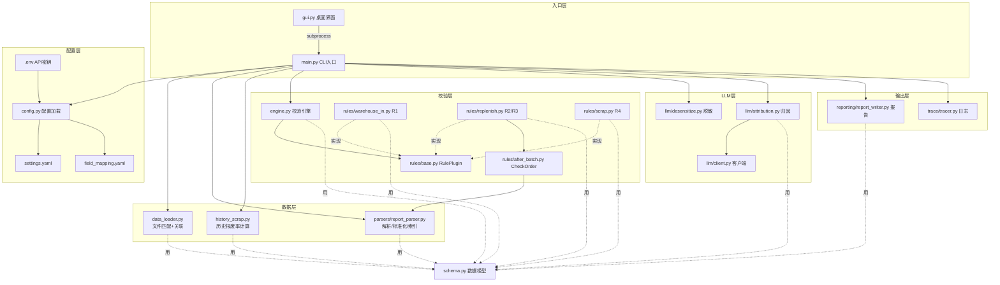

我先准确扫描文件清单，并读取核心模块的当前内容（保证逐行解释准确，不做任何修改）。

Glob 被 .venv 污染了，我直接读取核心模块的准确内容（parser/rules/llm 共 9 个文件）：

扫描完成。以下是完整梳理（只解释，不改任何代码）。

---

# 一、源文件清单（按目录分组）

## 项目根目录

| 文件 | 职责 | 依赖 | 被谁依赖 |
|---|---|---|---|
| `main.py` | CLI 入口：解析参数 → 数据源准备 → 校验 → 归因 → 报告，全程编排 | config、data_loader、engine、history_scrap、llm.*、parsers、reporting、rules.*、schema、trace | 被 `gui.py` 通过 subprocess 调用；被 `tests/test_cli_e2e.py` 调用 |
| `gui.py` | Tkinter 桌面界面：多选工厂、多选文件、subprocess 调 main.py、实时日志 | 仅标准库（tkinter/subprocess 等） | 无（用户直接 `python gui.py`） |
| `requirements.txt` | 依赖清单（pandas/openpyxl/pyyaml/pytest/requests） | 无 | pip 安装 |
| `pytest.ini` | pytest 配置（testpaths=tests） | 无 | pytest |
| `conftest.py` | 空文件，让 pytest 把项目根加入 sys.path | 无 | pytest |
| `.env` | DeepSeek API 密钥（`DEEPSEEK_API_KEY=sk-...`） | 无 | 被 `config.py` 的 `_load_dotenv()` 读取 |

## config/

| 文件 | 职责 | 依赖 | 被谁依赖 |
|---|---|---|---|
| `settings.yaml` | LLM 配置（provider/base_url/model/api_key/timeout）、trace/output 目录 | 无 | `config.py` |
| `field_mapping.yaml` | 各报表类型的**中文列名别名映射**（如"销售单号→订单号"、"投料扣除余数实际预大率→预大率"） | 无 | `config.py` → `ReportParser` |

## src/agent/（核心包）

| 文件 | 职责 | 依赖 | 被谁依赖 |
|---|---|---|---|
| `schema.py` | 数据模型：`StandardReport`（标准化报表）、`Anomaly`（异常）、`STANDARD_COLUMNS`、`REPORT_TYPES` | 无（纯 dataclass） | 几乎所有模块 |
| `config.py` | 配置加载：`load_settings`/`load_field_mapping`/`resolve_api_key`，含 `.env` 自动加载 | yaml、os、Path | main.py |
| `engine.py` | 校验引擎 `ValidationEngine`：注册规则、执行、错误隔离、去重 | rules.base、schema | main.py |
| `data_loader.py` | 文件自动匹配 `discover_files`、工厂归一化 `normalize_factory`、销售单号关联 `join_order_info` | pandas、Path | main.py、history_scrap.py |
| `history_scrap.py` | 历史报废率计算（复刻 VBA）：dataclass、`read_history_row`、`build_history_index`、`calculate_scrap_rates`、`match_history_columns`、`enrich_anomalies_with_metrics` | pandas、data_loader | main.py |

### parsers/

| 文件 | 职责 | 依赖 | 被谁依赖 |
|---|---|---|---|
| `report_parser.py` | 报表解析清洗（字段映射+质检）、产品编号标准化、订单过滤/索引构建 | schema | main.py、rules/after_batch.py |

### rules/

| 文件 | 职责 | 依赖 | 被谁依赖 |
|---|---|---|---|
| `base.py` | 规则插件基类 `RulePlugin`（抽象 `validate`） | schema | 所有规则文件 |
| `warehouse_in.py` | R1 违规入余数仓 | schema、base | main.py |
| `replenish.py` | R2 违规补投（有后批）、R3 重复补投 | schema、base、after_batch | main.py |
| `scrap.py` | R4 违规报废 | schema、base | main.py |
| `after_batch.py` | `check_has_after_batch`（复刻 VBA CheckOrder 两轮逻辑） | report_parser、pandas | replenish.py |

### llm/

| 文件 | 职责 | 依赖 | 被谁依赖 |
|---|---|---|---|
| `client.py` | LLM 客户端：`LLMClient`（抽象）、`MockLLMClient`、`OpenAICompatClient`（带重试/JSON模式） | requests | main.py、attribution.py |
| `desensitize.py` | 数据脱敏（客户/料号 → 哈希代号） | schema、hashlib | main.py |
| `attribution.py` | 归因：`build_prompt`、`parse_json_response`、`attribute_anomalies`、对比规则 | schema、client | main.py |

### reporting/ 和 trace/

| 文件 | 职责 | 依赖 | 被谁依赖 |
|---|---|---|---|
| `report_writer.py` | 报告生成 `write_excel_report`（Excel 三 sheet）、`write_markdown_summary` | attribution、schema、pandas | main.py |
| `tracer.py` | 执行日志 `Tracer`（JSONL 溯源） | json、time、Path | main.py |

### tests/（16 个测试文件，各对应一个源模块）

`test_schema` / `test_config` / `test_parser` / `test_rule_r1` / `test_rule_r2_r3` / `test_rule_r4` / `test_engine` / `test_tracer` / `test_llm` / `test_report_writer` / `test_cli_e2e` / `test_data_loader` / `test_product_order_index` / `test_after_batch` / `test_history_scrap`。

## 其他目录

- `data/samples/综合日报.csv`：早期样例（含 R1~R4 各一条的虚构数据）
- `docs/superpowers/specs/`、`plans/`：设计文档、实施计划
- `output/`、`logs/traces/`：运行时产物（报告、执行日志）
- 根目录下的 `.xlsx`：真实数据源（补投明细表、订单完成情况、历史报废率）

---

# 二、整体数据流（命令行 → 报告）

以工厂模式 `python main.py --工厂 金州厂` 为例：

```
main()                                # main.py 入口，argparse 解析参数
 ├─ load_settings() / load_field_mapping()   # config.py 读配置
 ├─ Tracer(...)                               # trace/tracer.py 建日志文件
 │
 ├─ discover_files(工厂, 根目录)              # data_loader.py 按文件名+列匹配3个文件
 │     ├─ 补投: glob *补投明细表*.xlsx
 │     ├─ 订单: glob *订单完成情况*.xlsx → 按"生产工厂"列认领工厂
 │     └─ 报废: glob *历史报废率*.xlsx → 按"组织"列认领工厂
 │
 ├─ pd.read_excel(补投) → 按"组织名称"过滤工厂 → parse_df()
 │     ├─ _map_columns()   # 别名→标准列名（销售单号→订单号 等）
 │     └─ _quality_check() # 数据质检 → D0 异常（缺订单号/重复行/非数字）
 │
 ├─ filter_order_by_products(订单全量, 补投成品)  # report_parser.py 功能一
 │     └─ build_product_order_index(过滤后)       # 功能二：型号订单索引
 │
 ├─ build_history_index(报废)          # history_scrap.py 历史报废率索引
 ├─ join_order_info(补投, 订单)        # data_loader.py 销售单号关联（精确/大行/未匹配）
 ├─ match_history_columns(补投, 历史索引)  # history_scrap.py 新增4列历史指标
 │
 ├─ build_engine() → engine.run(report)   # engine.py 执行 R1/R2/R3/R4
 │     ├─ RuleR1WarehouseIn.validate()
 │     ├─ RuleR2AfterBatch.validate()      # 调 check_has_after_batch()
 │     ├─ RuleR3DuplicateReplenish.validate()
 │     └─ RuleR4ScrapWithOnlineBoards.validate()
 │
 ├─ enrich_anomalies_with_metrics()    # history_scrap.py 补 预大率+4历史指标 进证据
 ├─ desensitize_report()               # llm/desensitize.py 脱敏
 ├─ _build_llm_client()                # llm/client.py 选 Mock 或 OpenAICompat
 ├─ attribute_anomalies(异常, client)  # llm/attribution.py
 │     ├─ build_prompt()               # 拼异常+预大率+历史报废率+对比规则
 │     ├─ client.chat()                # 调 DeepSeek
 │     └─ parse_json_response()        # 解析 JSON → Attribution 列表
 │
 ├─ write_excel_report()               # reporting/report_writer.py → Excel
 └─ write_markdown_summary()           # → Markdown 摘要
```

---

# 三、核心模块逐行解释

## 3.1 parsers/report_parser.py

**`_read_file(path, sheet)`（17-29 行）**：按扩展名读文件。`.xlsx/.xls` 用 `pd.read_excel`（可指定 sheet）；`.csv` 用 `utf-8-sig` 编码（兼容 Excel 导出的 BOM）。文件不存在/类型不支持则抛 `ReportParseError`。

**`_map_columns(df, aliases)`（32-42 行）**：核心是"别名→标准列名"映射。遍历 field_mapping.yaml 里每个标准列（如"订单号"）的别名列表（如 `[销售单号, 订单号, 单号...]`），找到第一个在报表里出现的别名，重命名成标准列。标准列已存在则跳过。

**`normalize_product_code_99(code)`（45-55 行）**：产品编号标准化。去空格、转大写；若倒数第 2-3 位是 `00`/`99`，统一成 `99`（如 `100497915C1000A → 100497915C1099A`）。用于后续订单匹配。

**`filter_order_by_products(df_order, df_main)`（58-74 行）**：功能一。取补投表的产品编号集合（标准化后），过滤订单表——只保留产品编号在补投表里出现过的订单行，并新增 `SO号-行` 拼接列。

**`build_product_order_index(df_filtered)`（77-104 行）**：功能二。遍历过滤后的订单，按 `(标准化产品编号, 生产工厂)` 建字典，value 是订单信息列表（下单时间/转工单时间/行号/赠品备品/订单大行/行状态/审核状态）。供 R2 的 `check_has_after_batch` 使用。

**`ReportParser.parse()`（111-118 行）**：读文件 → 调 `parse_df`。

**`parse_df()`（120-140 行）**：列映射 → 检查"订单号"列存在 → `reset_index` → 加隐藏列 `_行号`（=行号+1，对齐 Excel 行号）→ 质检 → 数值列 `to_numeric` → 返回 `StandardReport`。

**`_quality_check()`（142-172 行）**：三类数据质量问题（rule_id="D0"）：① 订单号为空 ② 完全重复的行 ③ 数值列存在非数字值。每条都生成一个 `Anomaly` 并带定位（第 N 行）。

## 3.2 rules/

**`base.py` — `RulePlugin`（7-15 行）**：抽象基类。定义 `rule_id`/`rule_name` 类属性 + 抽象方法 `validate(report) -> list[Anomaly]`。所有规则实现同一接口，保证引擎统一调用、可插拔。

**`warehouse_in.py` — R1（10-31 行）**：判断"在线有板且订单不够数时余数入库"。先检查所需 4 列是否存在（缺列则规则不适用返回空）；`mask` 用三个条件按位与（`入库数>0 且 在线数>0 且 已产出<需求`）；命中的行生成 Anomaly，证据带在线/已产出/需求/入库数。

**`replenish.py` — R2（9-40 行）**：违规补投（有后批订单）。先过滤"成品"；逐行算"订单大行"（销售单号去掉小行），调 `check_has_after_batch` 判断；状态是"是/上批订单预大不足"则生成异常，证据带后批订单大行列表。

**`replenish.py` — R3（43-70 行）**：重复补投。过滤"成品"；把补料日期归一成"天"（忽略时分秒）生成 `_补投日` 列；`duplicated(订单号, _补投日)` 找出同日同 SO 行的多行，按组生成异常，证据带同日补投记录数。

**`scrap.py` — R4（10-26 行）**：违规报废。`报废数>0 且 在线数>0` 即"在线仍有可用板却报废"，生成异常。

**`after_batch.py` — `check_has_after_batch`（69-75 行）**：R2 的核心判断。`_get_orders` 用 `(标准化产品编号, 去SUNTAK_前缀的工厂)` 查索引，无数据返回"无数据"，否则调 `_match` 返回状态。

**`after_batch.py` — `_match`（38-66 行）**：两轮逻辑。第一轮（43-55 行）：下单时间≤补料日期 且 转工单为空 且 小数位=1 且 非赠品(N) 且 不同大行 → "是"；第二轮（57-65 行）：转工单时间在 `[补料日期-7天, 补料日期)` 且 不同大行 → "上批订单预大不足"；否则"否"。

## 3.3 llm/

**`client.py` — `LLMClient`（9-12 行）**：抽象基类，`chat(messages) -> str`。

**`MockLLMClient`（15-24 行）**：无 API 密钥时用，返回固定格式归因 JSON（50 条占位），用于跑通链路。

**`OpenAICompatClient.chat`（39-63 行）**：真实调用。payload 带 `response_format={"type":"json_object"}`（强制 JSON）；`for` 循环重试 `max_retries` 次；401/403 鉴权错误不重试直接抛，429/5xx/网络错误重试（退避 `retry_backoff * (attempt+1)` 秒）。

**`desensitize.py` — `desensitize_text`（12-18 行）**：敏感值 → 代号（`前缀_序号_md5前8位`），同一原文稳定映射同一代号。**`desensitize_report`（21-29 行）**：对报表的"客户/产品料号"列做脱敏，返回副本+映射表。

**`attribution.py` — `build_prompt`（57-63 行附近）**：把每个异常拼成 `规则X「名称」：描述；证据：{json}`，并附加 `_history_analysis_block`（预大率+4历史指标+对比规则）。

**`attribution.py` — `_history_analysis_block`**：预大率为空→写"无预大率数据"；有值→列预大率+4指标+波动判断（`_volatility_flags`）+对比规则。

**`attribution.py` — `_volatility_flags`**：确定性算两层波动（阈值1 平均>剔除最高×1.5、阈值2 平均-剔除最高>0.10），返回提示文本。

**`attribution.py` — `parse_json_response`（66-77 行）**：正则提取模型回复里的 `{...}` JSON 对象 → 取 `results` 数组。

**`attribution.py` — `attribute_anomalies`**：先查每条异常的预大率，若 >100% 强制 category="数据错误"（跳过 AI）；否则用 AI 返回的 category（非法则钳制"其他"）；无返回则 fallback "未归因"。

---

# 四、Mermaid 架构图



**核心依赖关系一句话总结**：

- `schema.py` 是被依赖最多的"地基"（数据模型）。
- `main.py` 是唯一的编排器，串起所有模块。
- `rules/` 是插件层（`base.py` 定义接口，四个规则实现它），`engine.py` 统一调度。
- `llm/` 只被 `main.py` 调用（归因、脱敏、客户端），`attribution.py` 依赖 `client.py`。
- `data_loader.py` + `history_scrap.py` + `report_parser.py` 是数据处理三件套，供 `main.py` 编排。
- `gui.py` 完全独立，只通过 subprocess 调 `main.py`，不 import 任何业务模块。

这就是整个系统的完整架构和业务流程。